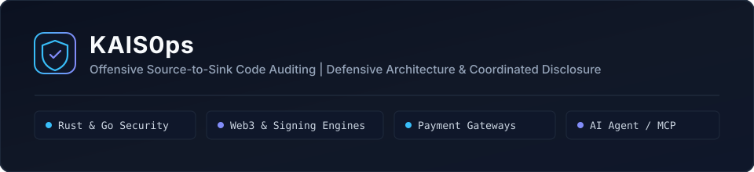

  

## Independent Security Research & Systems Engineering

`KAIS0ps` is a dedicated research handle for smart contract auditing, application security research, and defensive Rust tooling. Work focuses on static source-to-sink taint analysis, protocol conservation invariants, and coordinated vulnerability disclosure across decentralized finance (`DeFi`) protocols and open-source web software.

---

### Audit Scope & Engineering Focus

| Domain | Target Surfaces | Verification Approach |
|---|---|---|
| **Smart Contracts & DeFi Protocols** | `Solidity` (`EVM`) and `Rust` (`NEAR`) protocols: `ERC-4626` / `ERC-7540` vaults, lending and liquidation engines, cross-chain intent bridges, oracle feeds, and multi-decimal token accounting | Local `Foundry` (`forge test`) and `cargo test` PoCs against unmodified upstream commits, verifying conservation of value, keeper liveness, and realistic market bounds |
| **Modular Rust & Cryptographic Primitives** | Zero-dependency verification crates, constant-time `HMAC-SHA256` authentication, `EIP-712` / webhook replay bounds, and 256-bit fixed-point arithmetic | `#![forbid(unsafe_code)]`, strict `clippy` gates, deterministic boundary tests, and narrow module interfaces |
| **Web Platforms, APIs & Open-Source CMS** | `TypeScript` / `Node.js`, `PHP` (`WordPress`, `WooCommerce`, `OpenCart`), `Go`, and `Python` backends: SQL injection, broken access control, privilege escalation, SSRF, and unsafe deserialization | Isolated local reproduction harnesses, `CVSS v3.1` root-cause traces, and clean upstream `.diff` fixes |

---

### Open-Source Repositories

- **[vaultguard-rs](https://github.com/KAIS0ps/vaultguard-rs):** Zero-dependency `#![forbid(unsafe_code)]` Rust library and CLI for `ERC-4626` / `ERC-7540` vault share-math auditing, full-width 256-bit `mul_div` rounding checks, multi-decimal (`6`/`8`/`18`/`24`) truncation detection, async redemption conservation invariants, and oracle staleness bounds.
- **[payguard-rs](https://github.com/KAIS0ps/payguard-rs):** Zero-dependency modular Rust library and CLI for constant-time `HMAC-SHA256` webhook verification, replay-window enforcement, settlement state checks, and strict base-10 `uintN` bounds parsing.
- **[security-advisories](https://github.com/KAIS0ps/security-advisories):** Public archive of coordinated vulnerability disclosures (`CVD`), technical audit notes on DeFi triage falsification, `CWE` / `CVSS v3.1` analyses, and upstream patches published after official vendor remediation.

---

### Coordinated Vulnerability Disclosure (CVD)

All vulnerability research is executed strictly in isolated local environments without sending automated scans or test payloads to live third-party infrastructure.

Findings are submitted privately through official bounty and maintainer channels (`Immunefi`, `HackenProof`, `HackerOne`, `GitHub Security Advisories`, and accredited `MITRE CNAs` including `Patchstack` and `Wordfence`). Each report includes an unmodified local reproduction test, economic feasibility verification, and a proposed fix. No technical details are published before upstream patches are released and public disclosure is cleared.
